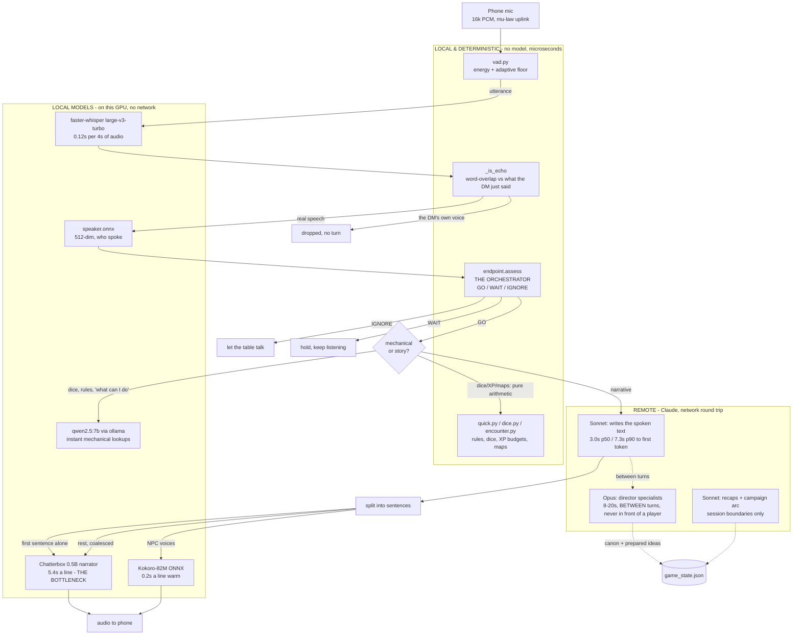
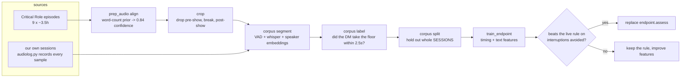

# What runs where, and what it costs

The design principle we're converging on: **do everything possible locally and
deterministically, and spend a network round trip only on the words a human will hear.**
Every box below is annotated with its measured cost, because the ones that surprised us were
all in places nobody had timed.

## The live turn



**`endpoint.assess` is the orchestrator.** It is the single gate deciding whether a network
round trip happens at all, and it is currently the weakest component in the system.

## The problem, in one number

Measured on real audio, not estimated:

| | responds to |
|---|---:|
| Matt Mercer, Critical Role C2E50 (1,754 labelled turns) | **13.8%** |
| `endpoint.assess`, our live rule | **90%** (70% even mid-sentence) |
| `endpoint.assess` returning IGNORE, ever | **0%** |

The rule has no concept of speech that isn't addressed to it, so it sends six times more
traffic to Claude than a human DM would answer — and each of those is a network round trip
plus a 5.4s narration. That is simultaneously the cost problem, the latency problem, and the
"it talks over us" problem.

## Where the time actually goes

| stage | measured | notes |
|---|---:|---|
| VAD, endpoint, echo, dice, XP | **~0ms** | pure Python, already deterministic |
| Speaker ID | ~ms | local ONNX |
| Whisper STT | **0.12s** | per 4s of audio; exonerated |
| Claude first token | 3.0s p50 / **7.3s p90** | the tail is what a table feels |
| Kokoro TTS | **0.20-0.23s** a line warm | see below: this row has now been wrong twice |
| **Chatterbox narrator** | **5.4s** | autoregressive, ~48 tok/s, batch-1 launch bound |

Chatterbox is now the single largest cost in a turn — larger than the language model.

## What a table waits for, which is not what one player waits for

Every stage above is measured with one player talking. A table is not that, and the difference
does not show up anywhere in the table above.

Each phone holds its own websocket, so four players are four independent callers into one DM.
The Claude Code backend is a single long-lived subprocess behind a single lock, so their turns
never overlapped — they **queued**, and the third player waited out both turns in front of
theirs. Every turn over a minute in the recorded sessions is this and only this: three people
speaking inside twenty seconds during combat.

Queueing is wrong twice over. It is slow, and what arrives at the end of the wait is worse than
nothing — an answer to *"I attack the closest one"* delivered a minute later lands in a fight
that has moved two turns on, and the table cannot tell a stale answer from a confused one.

A human DM takes them together. So does `turns.Desk` (one per campaign): a player who speaks
while the DM has the floor leaves their line at the desk, and whoever reaches the desk first
collects **every** waiting line and answers all of them in one turn.

Measured with `tools/concurrency_probe.py`, three players speaking 0.61s apart:

| | before | after |
|---|---:|---:|
| generations | 3 | **2** |
| worst wait | ~3 turns stacked | **12.3s** (one turn) |
| players answered | 3 | 3 |

Two generations rather than one is the correct floor, not a shortfall: the first player found
the desk free and went alone; the other two were collected. The rule is that however many
people speak *during* an in-flight turn, they cost **one** additional generation between them.

Two consequences worth naming. A line older than 45s is dropped rather than answered late.
And the answer is mirrored to the folded-in players' screens — one voice for the room, but
being answered inside someone else's turn must not look like being ignored.

This removes the *stacking*, not the per-turn latency; a single turn is still 8–12s here.

## The four brains, and which one a player waits on

| job | model | triggered by | on the critical path |
|---|---|---|---|
| Field reads, dice, XP, combat resolution | none, pure Python | `quick.answer`, `combat.brief` | ~0ms |
| Quick rules lookups | qwen2.5:14b (local) | `is_quick_question` | ~600ms |
| Combat narration | qwen2.5:14b (local) | `is_mechanical_turn` | ~37ms to first token |
| Story and everything else | **Sonnet**, via a persistent `claude` CLI process | default | **yes -- this is the wait** |
| Director (5 specialists) | Opus, one subprocess per role | the `TRIGGERS` table | **no** |

### Where the wait goes

Tracing the CLI's own event stream settles it. One turn, timestamped from the instant stdin
was written:

```
     5.8 ms  system     init model=claude-sonnet-5
  1686.2 ms  system     thinking_tokens
   ...       (five more)
  9865.8 ms  system     thinking_tokens
 10416.7 ms  assistant  blocks=['thinking']
 11098.7 ms  assistant  blocks=['text']    <- the first word the table hears
 11160.2 ms  result     cache_read=46811  out=764
```

Nine of eleven seconds is the model thinking before it speaks. Not the prompt, not the CLI,
not the network. `cache_read=46811` is why prompt size measures flat -- the 29KB system prompt
is served from cache, so trimming it was never going to buy anything.

`DM_THINKING_TOKENS=0` turns it off for the DM. Ten paired questions, interleaved:

| | median | mean | p90 | max |
|---|---:|---:|---:|---:|
| thinking on | 2853 | 3168 | 4609 | 7386 |
| thinking off | 2291 | 2518 | 3690 | **4112** |

The worst case improves most, which is the one a table feels. It is the right trade here
because the deterministic combat engine has already settled every number before the model is
asked -- there is little left to reason about before speaking. Prose was checked, not assumed:
24 replies per arm scored against the reference corpus, no rule breaks either way, thinking-off
slightly *less* fluffy and closer to reference length.

### The director does not interfere

It was a suspect on circumstantial evidence and the evidence was wrong. Three real Opus
specialists running against identical, interleaved DM turns:

| | median | mean | p90 | max |
|---|---:|---:|---:|---:|
| director idle | 2036 | 2283 | 2970 | 3172 |
| director busy | 2178 | 2132 | 2339 | 2423 |

The median moves 142ms while the mean, p90 and max all get *better* -- noise in both
directions. The architecture already had this right: separate OS processes, and
`pull_prepared()` never blocks, so the DM takes whatever Opus has already finished and never
waits for it. The kick is deliberately fired while Sonnet is still speaking.

### The TTS number, which this document has now got wrong twice

It said **0.96s** a line for months. That was replaced with **1.8-2.5s**, measured properly and
still wrong: those readings were taken while the GPU was carrying qwen2.5:14b, four Whisper
workers, and a benchmark of its own. Measured cleanly:

| | per line |
|---|---:|
| warm, GPU quiet | **232ms** |
| warm, qwen2.5:14b generating alongside | **343ms** (+48%) |
| the first lines after a fresh load | **~1900ms** |

Three lessons, in order of how much they cost:

**Cold is the real number nobody measures.** One short warm-up line left the engine loaded but
not fast: the opening sentences cost ~1.9s each and only then settled to ~230ms. That is where
the 6.4 seconds of synthesis in a real session opening came from — the server had restarted, so
the first narration paid the whole settling cost live, in front of the table. Warm-up now runs
several realistic lines *in the narrator's own voice*, because the voice embedding is part of
what settles. First real line after it: 196ms.

**Contention costs 48%, not 6x.** Worth knowing, and much smaller than the raw readings implied.

**espeak was rebuilt for every line.** kokoro_onnx phonemises through `phonemizer.phonemize()`,
the module-level convenience function, which constructs a fresh `EspeakBackend` on each call —
66ms a line of pure setup, byte-identical output, four times a reply. One backend is now kept.

The general lesson is about measurement, not TTS: every figure here was taken on a machine
doing something else, and the something else was usually me.

## Everything knowable in advance

The split is not by model speed, it is by **whether anyone is waiting**. Opus is not "the
expensive one" — it is the one that runs when the room is empty, and it can therefore be given
as long as it needs.

| written | when | by | played |
|---|---|---|---|
| the campaign arc (`state.plan`) | once, at creation | Opus | as context, every turn |
| the "previously on" (`recap.py`) | when a session ENDS | Opus, voiced in the same pass | instantly, 5ms |
| each location and beat (`prepared.py`) | once per scene, at session end | Opus | as material when the party arrives |
| the turn itself | live | Sonnet, thinking off | 2-4s |
| combat numbers | live | Python, no model | ~0ms |
| combat narration, quick lookups | live | qwen2.5:14b, local | 37-600ms |

### Facts, not sentences

Prepared scenes are `HERE / WHO / PLAYABLE / PRESSURE / COSTS / SECRET` — never prose. A party
can reach a beat in an order nobody planned, with the NPC already dead and the door already
open, and pre-written *sentences* would be confidently wrong. Recorded scene *facts* survive
being arrived at sideways. Sonnet interpolates from them; it never recites them.

The recap is the one exception voiced in advance, because a recap is the only narration whose
content cannot be invalidated by what the players do next.

### Which scenes

Not `drift.beats()`. That takes any line of six words or more, which is correct for measuring
similarity — noise costs nothing there — and wrong when every item becomes an Opus call: asked
for the next beats of a real campaign it offered *"Themes: innocence vs. a compromised world"*.
`prepared.scenes()` parses the plan's Locations and Story Beats sections instead. Locations are
the reliable half: a place is knowable in advance in a way an event is not.

Where the party is standing is matched **by name**, not by embedding. "Are they in Millhollow"
has a right answer, and a similarity score is the wrong instrument for a question that does.

### One narrator, all evening

Cached audio records the engine and voice that made it. Change either and the words are still
served but the recording is dropped and spoken live in the voice the session is actually using
— a recap in one narrator handing over to a session in another is more jarring than a slow
recap. The guarantee is mechanical, not a thing somebody has to remember.

## Offline: the training pipeline

Nothing here touches a live session.



The labels come from **timing, not transcripts** — for each moment a player stops, did the DM
take the floor? A published transcript records who said what, but not the pauses or the beats
where the DM deliberately stayed quiet, and those are the entire signal.

## The direction

Everything that can be arithmetic already is: dice, XP thresholds, encounter difficulty, map
geometry, initiative, HP. What remains expensive is the two model calls, and the fix for each
is different:

1. **Send Claude fewer turns.** A trained endpoint model at Matt's 13.8% rate instead of 90%
   would cut remote calls by most of their volume. This is the biggest single win available
   and it is a local model deciding locally.
2. **Make the narrator fast.** 5.4s is architectural — batch-1 autoregressive decode, so
   precision does nothing (measured: bf16 0.87x, tf32 0.93x, both *slower*). It needs CUDA
   graphs, a streaming decoder, or a different model.
