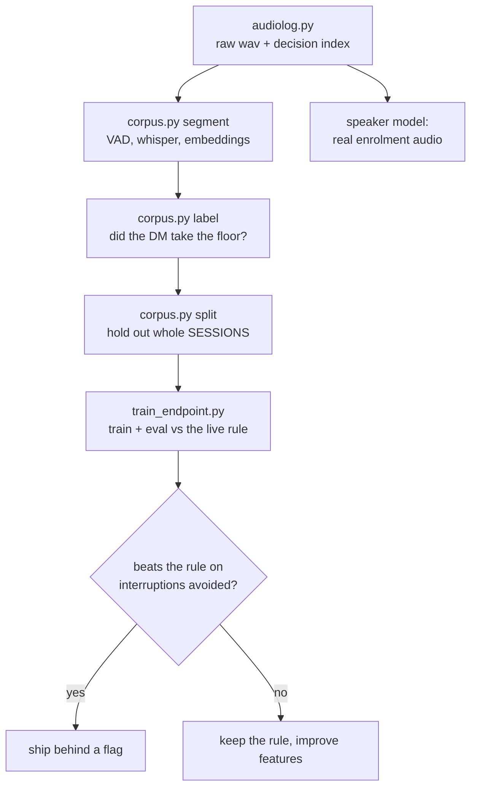

# Making it good at a table

The session with the group was bad in four specific ways: too slow, didn't listen well, heard
itself, and burned tokens. This is the plan to fix all four, and what has been measured so far.

Everything here is measured, not assumed. Two theories I was confident about today turned out
to be wrong (µ-law compression, and a "10k tokens per turn" figure that came from broken
instrumentation), so nothing goes in this document without a number behind it.

---

## What the measurements actually say

### 1. It answers almost everything — this is the big one

`endpoint.assess()` decides whether a heard utterance is a cue to speak. Scored against every
real player utterance ever logged (134 of them):

| DM state | GO | WAIT | IGNORE |
|---|---:|---:|---:|
| silent | **90%** | 10% | 0% |
| speaking | **70%** | 30% | **0%** |

**It has never once returned IGNORE.** There is no path by which table conversation is allowed
to pass. Every aside, every rules argument, every "hang on, let me find my sheet" is a cue to
respond — and 70% of them are enough to cut the DM off mid-sentence.

That single fact explains "not listening well", "talks over us", and most of "hears itself".
It is not a threshold that needs nudging; the rule has no concept of conversation that isn't
addressed to it.

### 2. It heard itself because the echo guard never ran

Fixed today. `_is_echo` measured length on *content* words, so a seven-word sentence carrying
three content words was written off as "too short to judge" and never compared at all. And
`water's` didn't match `water`, which alone dropped the overlap below the bar. The DM
interrupted itself seven times in ninety seconds.

Root cause is still acoustic — phone speaker into phone mic. Earbuds remove it at source.

### 3. The token numbers were not real

Telemetry logs `system=DM_SYS` (23,935 chars) on **every** turn. The DM runs a persistent
session where `--append-system-prompt` sends it **once**. It also logs `state` separately from
`message`, which already contains it. So the reported ~40,000 chars/turn is roughly double
counted, and the thing that actually grows — conversation history across 47 turns — isn't
measured at all.

**Nothing gets optimised until this is honest.** Fixing the instrumentation is a prerequisite,
not a task.

### 4. The slowness is TTS, not the model

Measured with `tools/bench.py`, same 101-character line, cache defeated:

| stage | p50 | p90 | verdict |
|---|---:|---:|---|
| STT (whisper, 4s clip) | **0.12s** | 0.13s | not the problem |
| LLM first token | 3.0s | 7.3s | the tail is here |
| TTS chatterbox (new line) | **6.05s** | 7.13s | **the bottleneck** |
| TTS kokoro (new line) | 3.66s | 3.76s | 1.65x faster, worse voice |

"The model was too slow" is mostly the narrator. Chatterbox costs **+2.4s per line** over
kokoro for the same text, on top of a 3.0s first token. STT is exonerated entirely at 0.12s
for four seconds of audio.

That reframes the fix: it is not a smaller model or a shorter prompt, it is pipelining —
speak sentence one while sentence two synthesises — plus deciding whether the better voice is
worth 2.4s a line. Both are measurable now without a table.

### 5. Where the time really goes

| route | model | n | p50 first token | p90 |
|---|---|---:|---:|---:|
| live DM | sonnet | 47 | 3.0s | **7.3s** |
| showrunner | opus | 40 | 8.9s | 9.9s |
| plot_weaver | opus | 39 | 12.5s | 17.6s |
| lorekeeper | opus | 39 | 14.7s | 20.6s |

The median is fine. The **p90 of 7.3s** is what a table feels. And 119 Opus director calls
landed in one session — three specialists firing on nearly every event.

---

## The program



### Phase 1 — data (done)

- `server/audiolog.py` records **every uplink sample** to `state/audio/<campaign>/<day>/*.wav`
  (16k mono, ~115MB/hour) with a `.jsonl` index marking every decision — `answered`, `held`,
  `ignored`, `echo` — at its exact sample offset.
- **The negatives are the point.** A model trained only on utterances we replied to cannot
  learn when to stay quiet, and until now the "held" and "ignored" cases existed nowhere.
- Writes go through a thread so the socket never blocks. `RECORD_AUDIO=0` disables.

### Phase 2 — corpus (built, needs audio)

`tools/corpus.py` — `segment` → `label` → `split` → `stats`, JSON out, proven end-to-end on a
synthetic 4-session table.

Labels come from **timing, not transcripts**: for each moment a player stops, did the DM take
the floor within 2.5s? Positive means respond, negative means let it pass. A published
transcript can't supply this — it has who said what, but not the pauses, the overlaps, or the
beats where the DM deliberately stayed quiet. Those exist only in audio.

`split` holds out **whole sessions**, never individual turns — the turn before and after a
held-out example share a conversation, voices and scene, so random splits score well by
recognising the episode rather than learning when to speak.

### Phase 3 — model (harness built, needs data)

`tools/train_endpoint.py` — `train` / `eval` / `sweep`. Features the rule never had: pause
length, speech rate, whether the sentence landed or trailed, whether it ends on a dangling
word, whether the DM spoke last. Text goes through TF-IDF into a logistic model whose opinion
becomes one more feature, so timing can override wording.

**It is always scored against the live rule on held-out sessions**, and the verdict uses the
real cost model: an interruption is worth ~3 missed cues, because speaking over the table is
what made the session unpleasant while a beat of silence self-corrects. (My first version of
this gate demanded recall parity — which guarantees the rule wins, because the rule buys its
recall by answering everything. That was the wrong question.)

### Phase 4 — latency and tokens (next)

1. Fix telemetry to report what is actually sent, including accumulated history.
2. Cut the p90, not the median — that's the number a table feels.
3. Director budget: 119 Opus calls per session is a choice, not a requirement. Fewer
   specialists per event, cheaper model for some, or fire on scene changes only.
4. Trim `DM_SYS` (23,935 chars) — much of it is combat rules that only matter in combat.

---

## Running it

```bash
# your own sessions record automatically; point the tools at them
python tools/corpus.py segment --audio state/audio/<campaign>/<day>/<file>.wav --out data/raw/<name>
python tools/corpus.py label   --session data/raw/<name> --speakers 6
python tools/corpus.py split   --root data/raw --test-frac 0.25
python tools/train_endpoint.py train --splits data/splits
python tools/train_endpoint.py eval  --splits data/splits    # vs the live rule
python tools/train_endpoint.py sweep --splits data/splits    # pick the operating point
```

## On training data

The pipeline takes any multi-speaker RPG audio. **Your own recorded sessions are the best
source** and now accumulate automatically — same room, same mics, same players, same phone
speaker echo, which is the environment the model has to work in. Podcast audio adds volume and
a wider range of table dynamics; point `--audio` at recordings you have the right to use for
this, and note that a model trained on studio-mic podcast audio will be learning a cleaner
acoustic world than the one it runs in, so it should be validated against your own sessions
either way.

## Status

| | |
|---|---|
| Raw audio + decision index | done, recording from next connect |
| Corpus pipeline | built, proven on synthetic, needs real audio |
| Endpoint model harness | built, trains and evaluates, needs real audio |
| Rule characterised | done — 90% GO, 0% IGNORE, pinned by a test |
| Echo guard | fixed |
| Speaker ID margin | fixed (0.06 → 0.15, self-training loop closed) |
| Telemetry honesty | done — `chars_sent` separates per-turn cost from total context |
| Latency attributed | done — TTS is the bottleneck, STT exonerated |
| Test isolation | done — suite no longer writes into the training corpus |
| Replay + sweep harness | done — tuning no longer needs five people in a room |
| Bulk archive ingest | done — `corpus.py batch`, resumable |
| TTS pipelining | not started — the biggest single latency win |
| Director token budget | not started — 119 Opus calls per session |
| Speaker model retraining | blocked on real enrolment audio |
